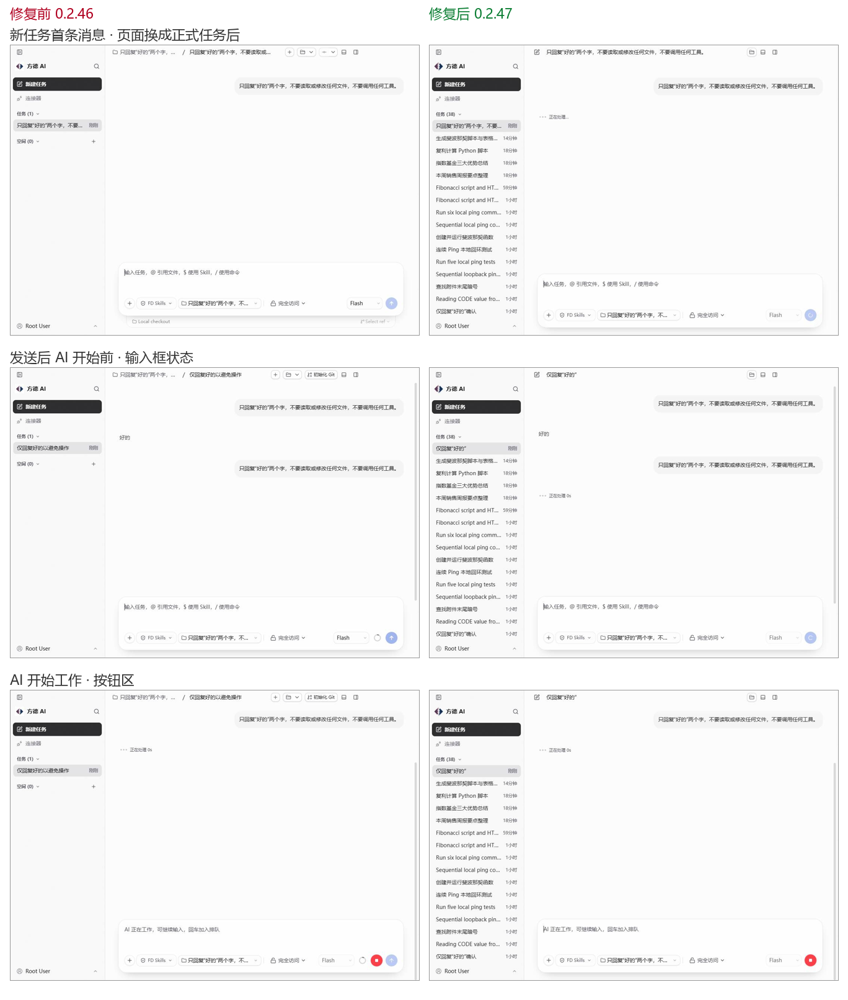
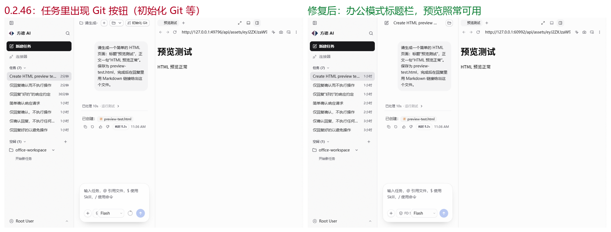
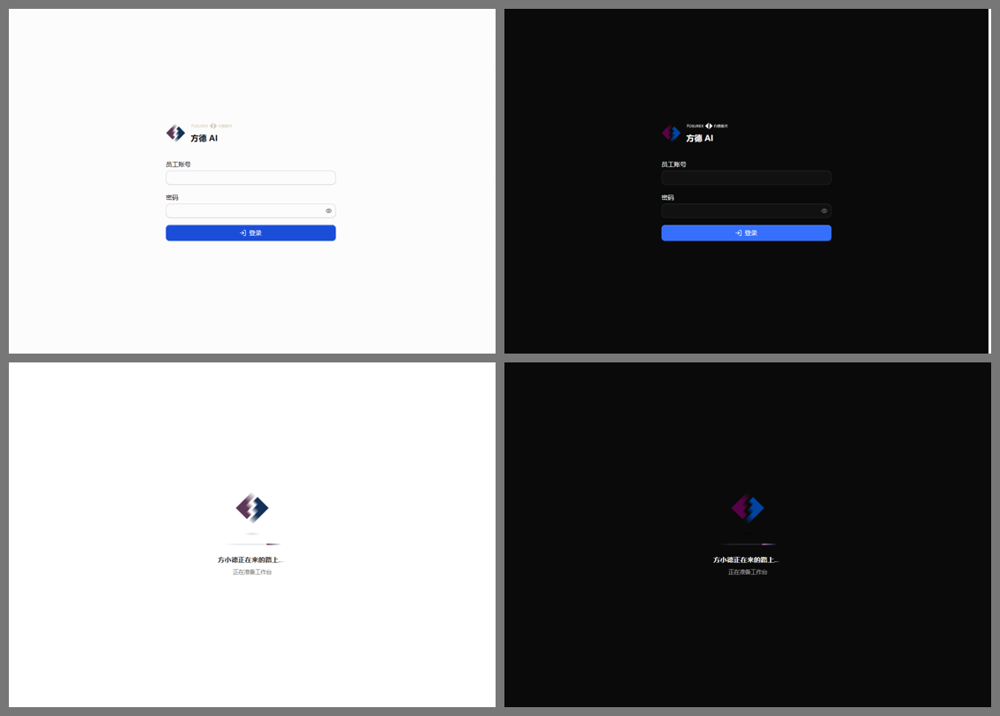

# 0.2.47：发送更稳、任务更清楚、全新启动页

## 员工可见改动

### 发送与输入框

- 发送消息后界面不再闪动：新任务第一条消息不再弹出 Git 工具条把输入框顶起，也不再整体重建页面；从“已发送”到“AI 开始回复”，输入框保持发送中状态，停止按钮原地替换发送按钮，模型选择不再被挤开。
- 去掉输入框旁的上下文用量圆环；需要时可单独发送 `/compact` 手动压缩。
- 打开正在运行的任务时，“正在同步消息…”提示不再一闪而过；旧版本保存的草稿不会因格式变化被清空。

### 任务

- 任务始终保持办公模式：顶部不再出现“初始化 Git”等开发者按钮。右侧面板（浏览器、文件、终端、变更、Agent）和底部终端照常可用。
- 顶部的终端、右侧面板两个按钮可以正常点击（此前鼠标点击会被当成拖动窗口，0.2.46 及更早版本均存在）。
- 新任务一律默认使用 Flash，不再沿用正在查看的任务所选模型；已有任务保留各自的模型。
- 任务名称（左侧列表）始终由 AI 生成简体中文标题，英文提问也一样。
- 任务文件夹改为“任务名*日期*时间”，例如 `整理本周销售周报的三个要点_2026-11-11_16-01`；规则见[任务与空间](../../user/tasks-and-spaces.md)。已有任务的文件夹不改名。

### 启动与登录

- 全新启动页“方小德正在来的路上”：标志两半汇合后沿小路浮动，状态文字随启动进度变化。启动、首屏、账号检查共用同一画面，过程中不再出现空白帧，也不再在启动较慢时误报“任务区暂不可用”（15 秒后仍未就绪才提示）。支持深色模式和“减少动态效果”。
- 登录页、加载页和错误页可以拖动窗口；登录页和侧栏标志改为透明底，深色模式下不再出现白色方块；“本地服务暂不可用”提示改为中文。

## 上游同步与安全

- Electron 升级到 44.10.1（Node Brotli CVE 与 10 月 Chromium 安全补丁）。
- 主窗口导航校验按协议和主机精确比较；桌面 IPC 只响应主窗口，方德演示编辑器只保留读取和保存两项权限。
- Codex：遇到未列出的错误码时任务正常结束，不再一直显示运行中；多次停止后审批仍会出现；写入失败不再让请求挂起；记录 App Server 退出原因与解码失败告警。
- 检查点与 Git：`core.safecrlf` 下保留 LF 文件；“从这里重来”会清理新 `.gitignore` 隐藏的文件，在首次提交前回退不再残留暂存；Git 错误统一按英文解析。
- 保存快捷键不再删除无法识别的规则；浏览器报告离线时仍连接本机服务；请求追踪和日志不再记录连接票据、签名资源地址和凭据参数。
- 依赖安全更新：undici、fast-uri、seroval、zod；`pnpm audit` 告警由 144 降至 76。

## 验证

自动化测试：

- 服务端：与改动前的 `main` 逐项对比，没有新增失败。新增测试覆盖快照读取 `project_purpose`、任务文件夹命名（中文、英文、符号、超长、同名、FD Skill）和中文标题重试。
- 网页、shared、client-runtime、contracts、Codex 包全部通过（唯一失败的 `Sidebar.snooze` 本地化用例在 `main` 上同样失败）；桌面端失败项与 `main` 相同。
- 服务端、网页类型检查通过。

真实应用回归（最终构建，Playwright 驱动桌面端，真实模型）：

| 场景                                                                                              | 结果 |
| ------------------------------------------------------------------------------------------------- | ---- |
| 新任务首条消息、追问：输入框位置 3 秒内不变，无 Git 工具条，页面不重建，停止按钮原地替换发送按钮  | 通过 |
| 新任务默认 Flash（从使用其他模型的任务点“新建任务”也一样）                                        | 通过 |
| 中文标题：中文、英文、代码类提问都得到简体中文标题；任务文件夹为“任务名*日期*时间”                | 通过 |
| 启动阶段与启动页：无空白帧，不误报“任务区暂不可用”；启动页、登录页可拖动（Windows 命中测试）      | 通过 |
| 顶栏终端、右侧面板按钮：真实点击打开面板；右侧终端、底部终端在任务文件夹执行命令，文件树打开 HTML | 通过 |
| 粘贴、排队、后台发送、停止、插话                                                                  | 通过 |
| HTML 文件标签在内置浏览器打开                                                                     | 通过 |
| 0.2.46 验收项（思考过程、代码高亮、从这里重来、生成 fib.py）                                      | 通过 |
| 界面综合（HEIC 图片、↑↓ 历史、草稿、撤销、重启 AI 会话、重新加载 Skill、设置项）                  | 通过 |
| 退出后重启：运行中的任务继续完成；关闭该设置后任务正常结束并说明原因                              | 通过 |

安装包：上传前从 CI 产物中直接解出 Windows 版，做登录、发送、启动页和按钮的冒烟测试（不运行安装程序，以免覆盖本机已安装的版本）。

## 发布

按[发布手册](../release.md)从已合并的 `main` 构建 Windows x64、macOS arm64 与 macOS Intel x64 安装包，验证后使用 Gateway 分片发布器上传并切换更新源。发布前公开版本为 0.2.46。
